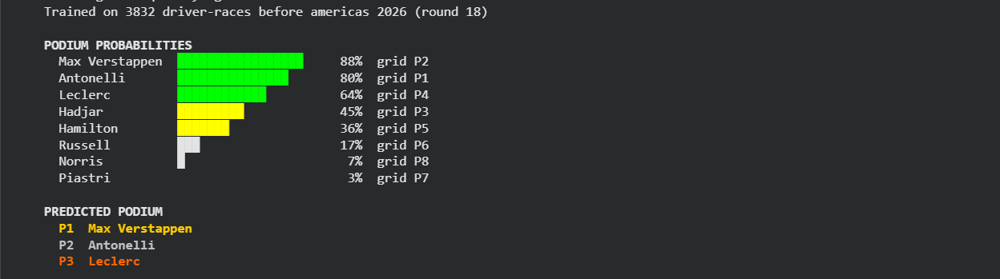
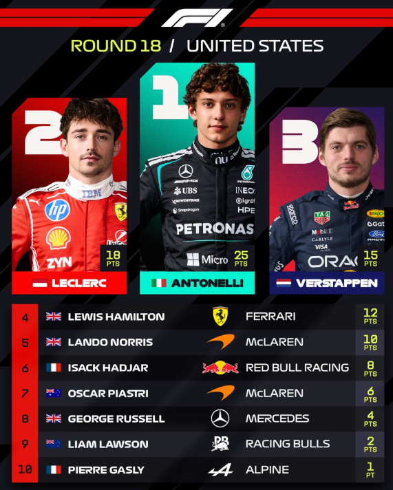

# F1 Podium Predictor 🏎️

A small ML project that tries to predict the top 3 of an F1 race using only what was known before the race. I tested it on the 2026 United States GP in Austin.

## Austin 2026 result

**What the model said**



**What actually happened**



| | Podium drivers correct | Exact order |
|---|---|---|
| Model | 3 / 3 | No |
| Grid top 3 (baseline) | 2 / 3 | No |

I had Verstappen winning, but Antonelli won. Right three drivers, wrong order.

The model was trained only on races before Austin (3,832 driver-race records), so it never saw the result.

## Backtest on the whole 2026 season

For each of the 18 races, I trained on everything before that race and predicted it.

| | Avg podium drivers correct | Exact order |
|---|---|---|
| Model | 2.00 / 3 | 3 / 18 |
| Grid top 3 (baseline) | 1.89 / 3 | 1 / 18 |

It's a small edge over the baseline, so I'm not claiming more than that. 18 races is not a lot of data.

## How it works

- **Data:** race results and qualifying from 2018 to 2026 (Jolpica F1 API, the new Ergast)
- **What the model looks at:** starting grid, qualifying position, how the driver has finished in the last 5 races, podium rate over the last 10, how strong the team has been lately, how the driver does at that track, and points so far this season
- **Two models:** one gradient boosting classifier picks who makes the podium, and a gradient boosting regressor guesses the finishing order
- **2026 counts more:** 2026 races are weighted 4x and 2025 races 2x, since the new rules changed the order of the teams
- **No peeking:** every feature uses only older races (`shift(1)`), so a race never sees its own result

## Run it

Easiest in Google Colab:

```
!pip -q install pandas scikit-learn requests
!python austin_podium_model.py          # Austin prediction only
!python austin_podium_model.py score    # compare it with the real result
!python austin_podium_model.py next     # predict the next race, run this BEFORE the race
```

The first run takes a few minutes because the API limits how fast you can download data.

## What it can't do (yet)

- No tyre strategy, weather or safety cars, so one bad lap or one safety car can ruin a prediction
- Exact order is hard. It's better at picking who, than in what order
- Grid penalties aren't counted in `next` mode
- Only about 18 races from the current rules era

## Next

- Add tyre strategy and weather
- Try practice session pace as a feature
- Feature importance, to see what the model actually relies on
- A proper pre-race prediction for Mexico City
